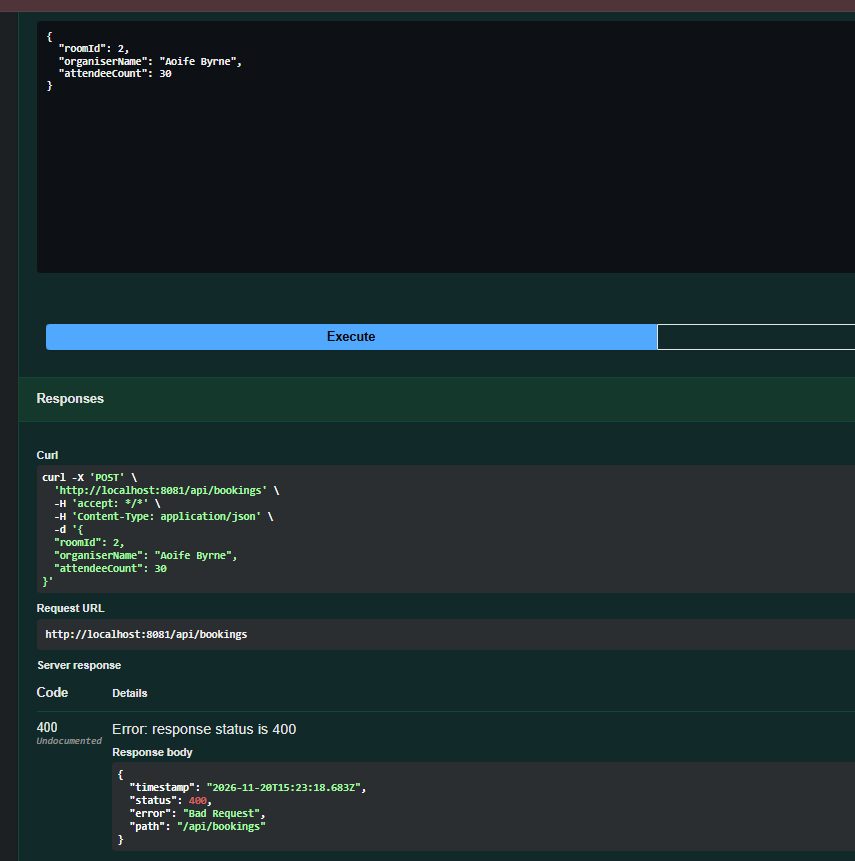
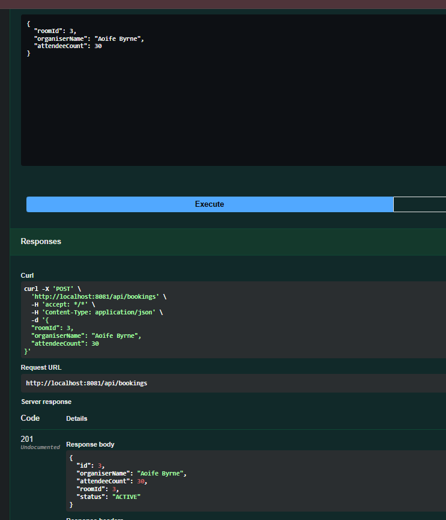
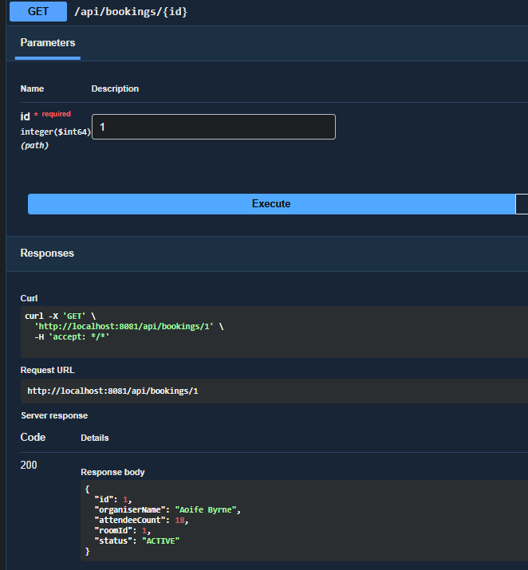

# CICD-1 Coding Test — Review, Improve and Reflect

**Student ID: G00465105**  
**Examination group:** A (Room Booking / JPQL) or B (OpenFeign): B (OpenFeign)
**Original examination pull-request URL (`exam-work`):** https://github.com/Franklin465105/G00465105/pull/1
**New review repository URL:**  https://github.com/Franklin465105/CICD1_ReviewG00465105

## 1. My original examination self-assessment

Review the code **as submitted in the original examination**. Do not change the original repository, branch or pull request. Check your own Group A or Group B examination paper and award marks only for evidence present in the original submission.

### Task 1 — /40
**My mark:** 13
**Evidence from the original code (files, methods, working or missing requirements):**
I created a Booking model with an ID, organiser name and attendee count, I also added basic validation using @NotBlank and @NotNull. I managed to have the basic structure started, but forgot the room ID and booking status. No request or response DTOs. Most of the required validation was missing.

### Task 2 — /40
**My mark:** 9
**Evidence from the original code:**
I created a BookingService and BookingRepository, I then tried to add bookings through the service and made a POST endpoint in SampleController. I realised that I could use ResponseEntity for the response, but booking wasn't being saved properly. No OpenFeign or room capacity checks.

### Task 3 — /20
**My mark:** 5
**Evidence from the original code:**  
I tried to make a getBookingById() method and used the BookingRepository to find bookings. I did make a GET endpoint in the controller, but had errors with findById() and the service method. The endpoint wasn't set up properly to receive an ID. There was no proper handling for bookings that don't exist.

**Total self-assessed original examination mark: 27/100**

**Checkpoint:** Commit this completed self-assessment as the **first review commit in your new repository**, before you modify or add application code. The lecturer decides the official original examination mark. (I did this but I had to clone the repo again cause I was working on the project at home)

## 2. Corrections and improvements in my new project

Start from a **fresh copy of the starter template for your own exam group**, in a **new GitHub repository**. You may consult or selectively reuse your own original examination code, but the new project must demonstrate that you understand and can correct it. Do not change your original examination submission.

Describe **two or three important problems** in your original code. For each, explain what was wrong, which class or method you changed in the new project, and why the corrected approach works.

Problem and correction 1:
In my original code, the addBooking() method wasn't saving bookings properly. I fixed this in BookingService by using bookingRepository.save(). This now saves the booking to the database correctly.

Problem and correction 2:
I didn't have any OpenFeign integration in my original code. I added RoomClient and updated BookingService to get room details from the Room Service. This also lets me check if the room has enough capacity before creating a booking.

Problem and correction 3 (optional):
My original getBookingById() method had errors with retrieving bookings. I fixed this in BookingService and BookingController. Bookings are now retrieved using their ID from the local database, with an error returned if the booking doesn't exist.

Problem and correction 4 (optional):
My original Booking model was missing the room ID and booking status. I added these fields to the Booking model in the new project. This means each booking now stores which room was booked and its current status.

## 3. API testing and evidence

Use Swagger UI or another HTTP client. For **at least four meaningful checks**, record the request/input, expected result, actual HTTP status/response, and pass/fail. Include unsuccessful cases; a running application alone is not enough.

**Test 1 — successful booking request:**
- Request / input: RoomId: 1, OrganiserName: Aoife Byrne, attendeeCount: 18
Expected: HTTP 201 Created. The system should successfully create a booking and return the booking details.
- Expected: HTTP 201 Created. The system should successfully create a booking and return the booking ID, organiser name, attendee count, room ID and status.
- Actual HTTP status / body: 201 Created. The system returned ID 1, organiser name Aoife Byrne, attendee count 18, room ID 1 and status ACTIVE.
- Pass / fail: Pass.

**Test 2 — invalid input or excessive attendee count:**  
- Request / input: RoomId: 2, OrganiserName: Aoife Byrne, attendeeCount: 11
- Expected: HTTP 400 Bad Request, with error message displaying.
- Actual HTTP status / body: HTTP 400 Bad Request. The booking was rejected, but the response body did not display an error message.
- Pass / fail: Half Pass

**Test 3 — missing booking or room:**  
- Request / input: Get api bookings: 1
- Expected: HTTP 200 OK. The system should retrieve the existing booking from the database and return the correct booking details. 
- Actual HTTP status / body: 200 OK. The system successfully retrieved the booking and returned ID 1, organiser name Aoife Byrne, attendee count 18, room ID 1 and status ACTIVE.
- Pass / fail: Pass. The booking was successfully retrieved, and all returned details matched the original booking information.

**Test 4 — requirement specific to my group:**  
- Request / input: RoomId: 2, OrganiserName: Aoife Byrne, attendeeCount: 30 and then after RoomId: 3, OrganiserName: Aoife Byrne, attendeeCount: 30
- Expected: Room 2 should return HTTP 400 Bad Request because its capacity is 10. Room 3 should return HTTP 201 Created because its capacity is 40.  
- Actual HTTP status / body: Room 2 returned 400 Bad Request. Room 3 returned 201 Created with ID 2, organiser name Aoife Byrne, attendee count 30, room ID 3 and status ACTIVE.
- Pass / fail: Pass.

**Group A:** Demonstrate `GET /api/bookings/search?roomName=...` using an exact room name, bookings ordered by attendee count descending, and an empty list for no matches. Add checks if necessary to show all three behaviours.

**Group B:** Run the **provided** Room Service separately on port 8082 and the **new** Booking Service on port 8081. Demonstrate that booking creation obtains room details through OpenFeign and that booking retrieval uses the local Booking database. Do not modify the Room Service.

With both services running, Booking Service checks room capacity through Room Service. Room 2 returned 400, while Room 3 returned 201 and with room service stopped, Booking Service still returned booking 1 with 200 OK. This proves retrieval uses the local Booking database.

## 4. Reflection

**What did I understand during the examination but struggle to implement?**  
I understood the general idea of how the booking system was supposed to work, but I struggled with putting everything together. I also missed the lab before the exam, where we covered DTOs, and I hadn't finished the work from that lab. Because of this, I didn't really understand DTOs properly going into the exam. I also had trouble getting the different classes to work together and saving bookings correctly.

**Which Spring Boot, JPA, validation, JPQL or OpenFeign concept became clearer after correcting my code? Give a specific example.**  
OpenFeign became a lot clearer after working on the new project. I didn't fully understand how two separate services communicated before. Now I understand how the Booking Service uses RoomClient to get room details from the Room Service and check the room capacity before saving a booking. I also understand JPA a bit better, especially how save() and findById() work with the database.

**What will I do differently in my next coding test or API development task?**  
I'll try to take my time more instead of rushing through the code. I'll work on one part at a time and test each endpoint before moving on. I'll also make sure I understand what each class is doing instead of copying code without fully understanding it.

## Review lab assessment — 20 marks

- Honest original self-assessment with code evidence: **4/4 marks**
- Explanation of mistakes and Spring Boot concepts: **4/6 marks**
- Corrections in the new application: **3/4 marks**
- API testing and demonstration of understanding: **2/4 marks**
- Reflection and future improvement: **2/2 marks**

**Total: 15/20 marks.** Simply submitting a working solution does not demonstrate the learning required by this review.

## Proposed mark recovery — only if confirmed for CICD-1

Around a 20-25% increase potentially. (Maybe lower would be fair aswell; not sure.)

If the same approach as OOP is adopted, the review could recover **up to 30% of marks lost** in the original examination, scaled by the review-lab mark.

**Marks recovered = (100 − official original exam mark) × 0.30 × (review lab mark ÷ 20)**

Example: exam **40/100** and review **16/20** → **14.4 recovered marks**, revised exam **54.4/100**. This is **not an approved CICD-1 policy unless confirmed by the lecturer**. The original official exam mark—not your self-awarded grade—is used in the calculation.

## Submission

Commit and push the **new review repository** with the completed README, corrected Spring Boot code and API-test evidence. Submit its GitHub URL on Moodle. **Do not push any changes to the original examination repository or `exam-work` pull request.**
